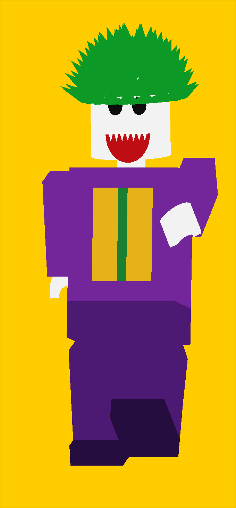
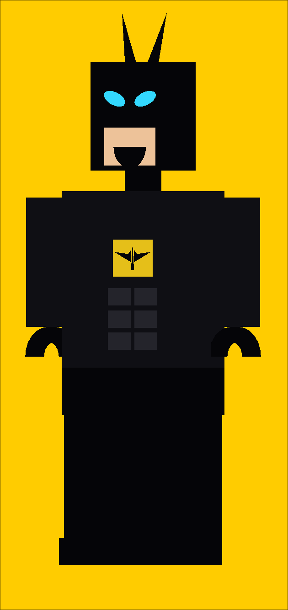

# CS675 Assignment 2 Submission by  "23b1817" + "23b2259"


We are creating 2 Lego-style minifigures, Batman and The Joker, modelled in OpenGL as a hierarchy of
rigid parts connected by joints. All geometry is built from triangles at
runtime (cuboids, cylinders, and flat shapes to make them more identifable Eg. the blue eyes/horns of batman and the smile and hair of joker) - no external modelling tool like blender was used.

The file names are a reference to the movie's ending.

## Build & Run

```bash
make
./ihateu
```

Requires GLFW, GLEW, and OpenGL (core profile 3.3). GLM is bundled under `glm/`.

## Hierarchy

Each minifigure is built by `buildMinifig()` in `ihateumore.cpp`, called once per
character with a different `MinifigStyle` (colours, hair, cape, face type). Both
figures share the exact same tree shape:

```
Root                          6 dof (tx,ty,tz,rx,ry,rz) - moves/orients the whole figure
└─ Pelvis                     rigid hub, 0 dof
   ├─ Torso                   rigid attachment to pelvis, 0 dof
   │  ├─ Cape (Batman only)   rigid mesh, 1 dof (rx) - ready for a swing animation (this is in its preliminary phase and hasn't been done in its full capacity)
   │  ├─ Neck                 1 dof (ry primary, rx limited) - turns/nods the head
   │  │  └─ Head               (+ hair / face decals, all rigid)
   │  ├─ L Arm                1 dof (rx) - shoulder swing
   │  │  └─ L Hand            1 dof (ry) - spins about the arm's own axis
   │  └─ R Arm → R Hand       mirror of the above
   ├─ L Thigh                 1 dof (rx) - hip swing
   │  └─ L Shin               1 dof (rx) - knee bend
   │     └─ L Foot            rigid, fused (no ankle)
   └─ R Thigh → R Shin → R Foot   mirror of the above
```

The root sits **above** the pelvis rather than being the pelvis itself, so that
"where does the figure stand and face" (root) stays conceptually separate from
"is it bending at the waist". This was mentioned in the assignment instructions. .

## Degrees of Freedom & Limits

| Joint | Axis | Range | Notes |
|---|---|---|---|
| Root | tx, ty, tz | unlimited | positions the whole figure |
| Root | rx, ry, rz | unlimited | orients the whole figure |
| Neck | ry | ±90° | turns the head left/right |
| Neck | rx | ±25° | nods the head |
| Shoulder (L/R Arm) | rx | -180° to 60° | swings the arm forward/back |
| Hand (L/R) | ry | ±180° | spins about the arm's long axis, like the real toy's clip-on hand |
| Hip (L/R Thigh) | rx | -90° to 30° | swings the leg forward/back |
| Knee (L/R Shin) | rx | 0° to 120° | folds forward only |
| Cape (Batman) | rx | 0° to 60° | unused this assignment, reserved for a swing animation |

All other axes on every joint are locked to 0° (`set_rot_limits(0,0,...)`), so a
joint can only move along the axis it's meant to.

### Why the legs have a knee but the arms don't

A real Lego minifigure's arm and leg are each a **single rigid piece** - there is no
elbow or ankle, and the only real joints are the shoulder, the hip, and the hand's
spin. But this assingment specifically asked for  knees, - so a joint was placed there.


## Controls

### Selecting what moves

| Key | Selects |
|---|---|
| `TAB` | switch the active figure (Batman ↔ Joker) - camera recenters on the newly active figure |
| `1` | root (whole figure) |
| `2` | neck |
| `3` / `4` | left / right arm (shoulder) |
| `5` / `6` | left / right thigh (hip) |
| `7` / `8` | left / right shin (knee) |
| `9` / `0` | left / right hand |

### Moving the selected joint

| Key | Effect |
|---|---|
| `←` / `→` | rotate about y |
| `↑` / `↓` | rotate about x |
| `,` / `.` | rotate about z |
| `J` / `L` | translate along x |
| `I` / `K` | translate along y |
| `U` / `O` | translate along z |
| `R` | reset the selected joint to its saved rest pose |

All movement keys respond to both a tap and a held press (`GLFW_REPEAT`).
Rotation keys respect each joint's limits, listed above.

### Camera & display

| Key | Effect |
|---|---|
| `A` / `D` | orbit camera about y |
| `W` / `S` | orbit camera about x |
| `Q` / `E` | orbit camera about z |
| `P` | toggle perspective / orthographic projection |
| `F` | toggle wireframe / solid |
| `Esc` | quit |

The camera always orbits around and looks at whichever figure is currently active
(set by `TAB`), so switching characters immediately brings the new one into frame.

## Joker



## Batman



## Modelling Notes

- **VBO/VAO per part**: every rigid body part (torso, each arm segment, each hand,
  each leg segment, the head, the cape) is its own `HNode` or what intuitively a joint, cause we rotate and start from the joint as is explained in the Pivots part, each with its own VAO
  and VBO, created inside `HNode`'s constructor.
- **Pivots**: every part's mesh is built relative to its own joint at the local
  origin - a hanging limb spans from `-h` to `0` in local y, a standing part spans
  `0` to `h` - so that rotating a joint pivots the part correctly rather than
  spinning it about its own centre.
- **Decorative geometry**: face features (eyes, mouth), the chest emblem/tie, and
  ab lines are built as flat triangles layered onto the front of the torso/head
  meshes, offset slightly outward to avoid z-fighting( which surface is rendered in the pixel) with the surface underneath.
  Hair is a dome of small triangular spikes grown outward from an imaginary
  sphere fitted to the head (very proud of this solution for hair).
- **Hollow hand**: the clip-style hand is a genuinely hollow half-ring (an outer
  and inner radius), not a solid wedge, matching the real minifig's C-shaped hand.

## Planned for the Animation Assignment

- The cape already has a swing dof (`rx`, 0°–60°) wired up but unused this
  assignment - intended for a walk/run cycle, future batman joker animations inspired from the movie.
- Root's full 6 dof will drive translating the figure across the scene for a
  walk cycle, without needing any hierarchy changes.

